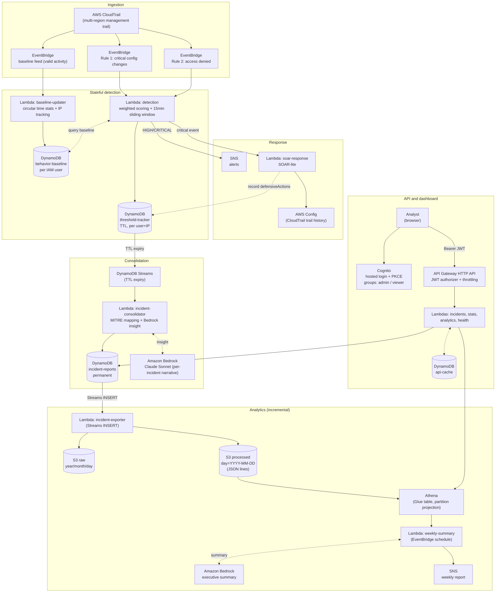

# SIEM Lite

[](https://github.com/Diego-do-na/SIEM-Lite/actions/workflows/ci.yml)

A serverless, event-driven SIEM built end-to-end on AWS: stateful detection, AI-assisted triage, automated response, incremental analytics, and a read-only authenticated API. Everything is defined as code (Terraform), scanned in CI (Checkov), and replicable in any AWS account with `terraform apply`. Designed as a portfolio project that reflects real security-engineering trade-offs, not just working code.

> Detection → triage → response → analytics → API runs end-to-end on AWS, validated against real deployments.

---

## Table of contents

- [Why this project](#why-this-project)
- [Architecture](#architecture)
- [Pipeline walkthrough](#pipeline-walkthrough)
- [API and dashboard](#api-and-dashboard)
- [Rule 3: behavioral baseline (optional module)](#rule-3-behavioral-baseline-optional-module)
- [Deploy it yourself](#deploy-it-yourself)
- [Key design decisions](#key-design-decisions)
- [Known limitations](#known-limitations)
- [Tech stack](#tech-stack)
- [Repository structure](#repository-structure)
- [Documentation](#documentation)
- [Roadmap](#roadmap)
- [References](#references)

---

## Why this project

Most "SIEM in the cloud" tutorials stop at "CloudTrail → Lambda → alert". SIEM Lite goes further on purpose:

- **Stateful detection**, not single-event rules: activity is scored and accumulated per user/IP over a sliding window.
- **AI-assisted triage**, not AI-as-classifier: an LLM (Amazon Bedrock) writes the analyst-facing incident narrative *after* a deterministic scoring engine has already decided severity, never the other way around.
- **Automated, reversible response (SOAR-lite)** for a narrow, well-justified set of destructive actions, with an explicit, documented boundary on what it will *not* do.
- **A real analytics tier** (S3 + Glue Data Catalog + Athena) behind the operational path, fed incrementally per incident, with no batch jobs to babysit.
- **A secured API and dashboard** (Cognito + JWT authorizer, rate limiting, input validation, cache by version) instead of treating "the dashboard" as an afterthought.
- **Infrastructure as code with a security gate**: Terraform, Checkov in CI, and a protected `main` branch that can't be merged with a failing scan.

Every non-obvious decision below is deliberate and documented, including the ones that didn't make it into 1.0.

## Architecture



## Pipeline walkthrough

1. **Ingestion.** A single multi-region CloudTrail trail (`siem_management_events`) captures all management read/write events. Two EventBridge rules split the stream by intent: **Rule 1** watches a small set of critical configuration changes (disabling logging, deleting the trail, disabling/scheduling deletion of the KMS key, Security Group changes); **Rule 2** catches any `errorCode` (access denied) regardless of service, so new denied-action types don't require a rule change.

2. **Stateful detection** (`detection`). Each matching event increments a per-action, per-`(user, sourceIP)` score in DynamoDB (`threshold_tracker`), inside a genuinely sliding 15-minute window: the TTL is recomputed on every new event rather than set once. Four "destructive" actions (`StopLogging`, `DeleteTrail`, `DisableKey`, `ScheduleKeyDeletion`) always contribute to the running score, even with legitimate credentials, because disabling your own audit trail is inherently suspicious. Everything else only scores after enough repetition to cross a threshold.

3. **Automated response (SOAR-lite)** (`soar_response`). Invoked asynchronously by the detection Lambda only for the four critical actions. It restarts CloudTrail logging, re-enables/cancels deletion of the KMS key, or recreates a deleted trail by reading its last known configuration from **AWS Config**. Idempotent per `(action, targetResource)` so retries never double-remediate. Explicitly scoped to *protecting the resource*, not chasing the attacker (see [Known limitations](#known-limitations)).

4. **Consolidation & AI triage** (`incident_consolidator`). When a Table 1 item expires, DynamoDB Streams (filtered to real TTL expirations, never manual deletes) triggers this Lambda. It maps the accumulated actions to MITRE ATT&CK techniques, computes a per-action score breakdown, and makes **one synchronous call to Amazon Bedrock (Claude Sonnet)** to generate a 3-paragraph analyst narrative: what happened, why it matters (with the MITRE technique), and what to do next given what SOAR already mitigated. The finished incident is written once to `incident_reports` (no TTL, permanent record). If Bedrock fails, the incident is still saved with a fallback message instead of being lost.

5. **Incremental analytics** (`incident_exporter`). Every new incident that lands in the permanent table is streamed (Streams `INSERT` only) to S3 twice: a **raw** copy (`year=/month=/day=/<id>.json`, the unmodified record) and a **processed** copy as a single JSON line under `incidents/day=YYYY-MM-DD/<id>.json`. A Glue Data Catalog table with **partition projection** on that one `day` date partition exposes it to Athena: no crawler, no Glue job, no partition-registration step. Every query must filter on `day`; this is enforced in the code that builds the SQL (see [decisions](docs/decisions.md)).

6. **Weekly report** (`weekly_summary`). An EventBridge schedule fires a Lambda that queries Athena for the trailing 7 days, aggregates by severity, source IP and MITRE technique, and, only if there is activity, asks Bedrock for a short executive summary before publishing to SNS. Bedrock receives the aggregates, never raw incident data.

> Resource names carry a configurable prefix (default `siem-lite-`), so a copy can live next to an existing deployment in the same account.

## API and dashboard

A read-only HTTP API exposes the incident store to a static dashboard.

- **Authentication:** Amazon Cognito user pool with hosted login (Authorization Code + PKCE), `admin` and `viewer` groups, admin-create-only (no self sign-up). API Gateway validates the JWT before any code runs.
- **Endpoints:** `GET /incidents` (filters, keyset pagination across severities), `GET /incidents/{id}`, `GET /stats` (counts and trend), `GET /analytics/{report}` (fixed Athena reports: top IPs, MITRE techniques, severity trend, score distribution; `days` limited to 7/30/90), `GET /health`. Full reference in [docs/api.md](docs/api.md).
- **Two separate defenses:** token validation (who may call) and input validation (what they may ask: allow-listed parameters, bounded sizes, no free-form SQL).
- **Abuse and cost control:** stage throttling (10 req/s, burst 20), CORS limited to `dashboard_origins`, and a **cache keyed by data version** (the timestamp of the last incident), so repeated dashboard loads never re-run Athena unless there is new data. Timed-out Athena queries are explicitly stopped.
- **Dashboard:** vanilla JS single-page app (no build step, no dependencies) in `frontend/`; tokens in `sessionStorage`, all untrusted text rendered with `textContent`. Static hosting on private S3 + CloudFront (OAC, security headers) is the next infrastructure step; today it runs locally against a deployed API ([deployment](docs/deployment.md)). The UI is being redesigned.

## Rule 3: behavioral baseline (optional module)

Rule 3 (`ENABLE_BEHAVIOR_BASELINE`, default `false`) is a **context multiplier on top of the weighted score, not an independent detector**. With the flag off, the rest of the system behaves exactly as if Rule 3 didn't exist.

- **What it does:** learns each IAM user's typical hour-of-day and source-IP ranges from their own valid activity, then multiplies the score of a new event by how far it deviates from that pattern.
- **Method:** circular statistics (Jammalamadaka & Lund, 2006): each observed hour becomes a unit vector on a 24-hour circle; the running sin/cos sums give a circular mean hour and a concentration $R$, from which the anomaly is a distance in standard deviations, floored at 1 hour. This avoids the discontinuity a linear hour-difference would have at midnight, and needs no labeled training data.
- **Why not ML:** there's no real, labeled attacker traffic in this account: all test traffic was generated by the author. ML is deferred to a later release, to be evaluated only against real accumulated data.
- **Safeguards:** cold start is neutral (multiplier = 1.0 until a user has enough distinct active days); critical actions never have their score *reduced* by the baseline, only amplified; only IAM users get a baseline (roles and services don't); only incremental accumulators are stored (sums, not a timestamp history), so the item size never grows with volume.

### The math

Each active hour bucket for a user contributes one unit vector. For an event at hour $h$ and minute $m$:

$$\theta = 2\pi \cdot \frac{h + m/60}{24}$$

Instead of storing every $\theta$, only the running sums are kept (that's what makes the accumulator constant-size):

$$S = \sum_{i=1}^{n} \sin\theta_i \qquad C = \sum_{i=1}^{n} \cos\theta_i$$

From those sums, the mean resultant length $R$ (how concentrated the user's activity is around one hour, from $0$ = scattered to $1$ = always the same hour) and the circular mean hour $\bar\theta$:

$$R = \frac{\sqrt{S^2 + C^2}}{n} \qquad \bar\theta = \text{atan2}(S, C)$$

The circular standard deviation, floored at 1 hour ($\sigma_{min} = 2\pi/24$ radians):

$$\sigma = \max\left(\sqrt{-2 \ln R},\ \sigma_{min}\right)$$

The new event's angular distance from the mean, wrapped correctly around midnight, then standardized:

$$d(\theta, \bar\theta) = \left|\left((\theta - \bar\theta + \pi) \bmod 2\pi\right) - \pi\right| \qquad z = \frac{d(\theta, \bar\theta)}{\sigma}$$

$z$ is mapped to a signal $s \in [-1, 1]$ ($z_{low}=1$, $z_{high}=3$ by default: clearly normal to clearly anomalous):

$$s = \text{clamp}\left(\frac{z - \frac{z_{low}+z_{high}}{2}}{\frac{z_{high}-z_{low}}{2}},\ -1,\ 1\right)$$

Confidence grows with distinct active days $d$ seen so far, toward $N_0 = 14$ by default:

$$\text{confidence} = \min\left(1, \frac{d}{N_0}\right)$$

Time and IP multipliers ($A$ = time amplitude, default $0.5$; $b$ = IP bump: $0$ known, $0.25$ new IP in a known range, $0.75$ never-seen range):

$$m_{time} = 1 + \text{confidence} \cdot A \cdot s \qquad m_{ip} = 1 + \text{confidence} \cdot b$$

And the final multiplier applied to the action's weight, capped at $M_{max} = 2.0$:

$$M = \min\left(m_{time} \cdot m_{ip},\ M_{max}\right)$$

**Privacy note.** Even in this reduced form, Rule 3 is behavioral profiling: it records when and from where a person works. Mitigations in place: only aggregated accumulators are kept (no per-event timeline), IP records expire after 30 days, the query path has read-only least-privilege IAM access, and no user-identifying data is written to CloudWatch. A deployment against real employees, rather than a personal test account, would need a defined purpose, employee notice, and a legal/HR review before enabling this flag.


## Deploy it yourself

```bash
cd backend/infra
cp terraform.tfvars.example terraform.tfvars   # set aws_region and alert_email
terraform init
terraform apply
```

- `alert_email` receives SNS alerts (confirm the subscription email) and becomes the first Cognito admin; Cognito emails a temporary password.
- Safety switches: `enable_cloudtrail` (default `false`), `enable_config` (default `false`), `enable_event_rules` (default `true`; `false` deploys everything without wiring CloudTrail events into detection), `enable_behavior_baseline`, `enable_cli_auth` (default `false`, test-only).
- Guard rails on by default: CloudWatch alarms (API 5xx/4xx, Lambda errors) on a dedicated SNS topic and an AWS Budget (`monthly_budget_usd`, default 5) with email alerts.
- Requires Bedrock access to `bedrock_model_id` in the target region.
- Destroying: raw/processed buckets must be emptied first, and rules/Lambdas removed before deleting a CloudTrail trail, otherwise SOAR recreates it. Steps in [docs/deployment.md](docs/deployment.md).

Cost is pay-per-use and idles near zero (on-demand DynamoDB, Lambda, HTTP API); Bedrock, Athena and CloudTrail/Config data scale with real activity.

## Key design decisions

| Decision | Why |
|---|---|
| DynamoDB over RDS/Aurora | Avoids VPC and connection-pool complexity; fits a fully serverless design end to end. |
| Two DynamoDB tables (ephemeral + permanent) | A single table with TTL would risk expiring records meant to be kept; separating "working state" from "case record" removes that failure mode entirely. |
| Weighted action pool per `(user, IP)` instead of a flat counter | Different actions carry different risk; a map (`actionCounts`/`configChanges`) lets each action keep its own count, score, timeline and context, at the cost of a 3-step nested `update_item` pattern to work around DynamoDB's "overlapping document paths" restriction. |
| Bedrock called once, synchronously, inside the consolidator | Keeps the insight generation on the write path (computed once, read many times) instead of re-generating it on every read or adding another Lambda hop. |
| Bedrock triage after scoring, never before | The LLM never decides severity: it explains a decision a deterministic engine already made. This keeps the alerting path auditable and removes the LLM as a single point of failure for detection itself. |
| SOAR scoped to "protect the resource," not "punish the actor" | No credential revocation or user disablement: that requires an identity-governance system with its own blast-radius analysis, out of scope here by design. |
| SOAR only reports success after verifying the final state | A recreated trail that is not logging is not a remediation. Found as a real bug: `create_trail` doesn't start logging. |
| Incremental ETL instead of a weekly Glue batch | The first design batched raw data into Parquet weekly. Replaced by writing one small JSON line per incident at insert time: no job to schedule or fail, data queryable immediately, and at this volume Parquet gives no benefit. Parquet + compaction returns in 1.1 when volume justifies it. |
| One date partition with projection, and a mandatory `day` predicate | Year/month/day projection over several years created thousands of candidate partitions and made queries on seven files take 14 to 100 seconds; a single projected date partition brought them to about a second. Partition pruning has to be a rule, not a habit. |
| Cache keyed by data version, not only by time | Dashboards re-query constantly; the version (last incident timestamp) invalidates exactly when data changes. A 60 s floor and per-endpoint max age bound staleness and cost. |
| HTTP API + Cognito JWT authorizer, read-only | Lowest cost and least surface: no writes through the API in 1.0, authentication enforced before the Lambda runs. |
| Alarms on a separate SNS topic | CloudWatch cannot publish to a topic encrypted with the AWS-managed `alias/aws/sns` key; a customer-managed key is planned for 1.1. |
| Terraform + Checkov as a merge gate | `main` is protected: PR required, and both `Terraform validate` and `Checkov` must pass. Verified with a deliberately failing PR. Accepted risks are skipped with a written reason. |

## Known limitations

Documented deliberately, because a security project that only lists what works isn't credible:

- The system assumes credentials are legitimate; detecting a *compromised* credential behaving normally would require full UEBA, out of scope for this version.
- Tested on accounts with no other workload; testing doesn't cover the noise of a real, actively-used account beyond what was simulated. Detection with real CloudTrail events, and the `enable_cloudtrail` / `enable_config` paths in a fresh Terraform deployment, are validated manually rather than by automated tests.
- Table 1's key is `(user, sourceIP)`: an attacker who rotates IPs mid-attack currently splits their score across items instead of accumulating it (planned for 1.1).
- Rule 3 has a cold-start blind spot: a brand-new user has a neutral multiplier for their first weeks. Rules 1 and 2 (and the base `ACTION_WEIGHTS`) still protect during that window.
- The hourly baseline is unimodal: a user with split shifts (e.g. 9-14 and 20-23) gets averaged toward an hour they never actually work.
- The IP signal produces false positives for a single user who legitimately appears under several source IPs (IPv4, IPv6, a privacy relay), confirmed in testing with Safari's "Hide IP from Trackers," which routed console traffic through a Cloudflare relay IP.
- Rule 3 is triage (it adjusts priority), not detection: it never flags anything Rules 1 and 2 wouldn't already flag, and with self-generated test data its separation power can't be rigorously measured. The baseline only covers IAM users.
- Cognito MFA, AWS WAF, customer-managed KMS keys, S3 access logs and dead-letter queues are not in 1.0 (Checkov skips are listed in `backend/infra/.checkov.yaml` with reasons). Data is encrypted at rest with AWS-managed keys.
- The long-lived IAM key used to administer the test account should be replaced by SSO or role-based access in a real environment.
- The API lists and filters incidents with DynamoDB filter expressions, which is fine at this volume and will need Athena-backed search at scale.

## Tech stack

**AWS:** CloudTrail, EventBridge, Lambda (Python), DynamoDB (+ Streams), SNS, Amazon Bedrock (Claude Sonnet), AWS Config, S3, Glue Data Catalog, Athena, API Gateway (HTTP API), Cognito, CloudWatch, AWS Budgets.

**Infrastructure and CI:** Terraform (AWS provider 6.x), GitHub Actions (`terraform validate`, Checkov), branch protection on `main`.

**Frontend:** vanilla HTML/CSS/JS, no build step. Planned hosting: private S3 + CloudFront.

## Repository structure

```
backend/
  functions/
    pipeline/    detection, baseline_updater, soar_response,
                 incident_consolidator, incident_exporter, weekly_summary
    api/         incidents, stats, analytics, health
  shared/        scoring, MITRE map, behavior baseline, API utilities
  infra/         Terraform (one file per resource type) + .checkov.yaml
frontend/        static dashboard (config.example.js -> config.js)
scripts/         smoke-test.sh, seed-incidents.sh
docs/            architecture, api, security, deployment, testing, decisions, roadmap
.github/workflows/ci.yml
```

## Documentation

| Doc | Contents |
|---|---|
| [architecture](docs/architecture.md) | Components, data flow, guard rails |
| [api](docs/api.md) | Endpoints, parameters, errors |
| [security](docs/security.md) | Query-path threat model, authentication, frontend hosting, known gaps |
| [deployment](docs/deployment.md) | Variables, deploy, first login, verify, tear down, CI |
| [testing](docs/testing.md) | CI, local Lambda tests, checks against real AWS (smoke test, seed script) |
| [decisions](docs/decisions.md) | Numbered decisions for the API, analytics and dashboard |
| [roadmap](docs/roadmap.md) | 1.0 closing items, 1.1 and 1.2 |

## Roadmap

**Closing 1.0:** host the dashboard on S3 + CloudFront, a redesigned UI, and a full validation of the Terraform deployment with real CloudTrail and Config.

**1.1 (hardening and depth):** Cognito MFA, WAF, customer-managed KMS keys, dead-letter queues and S3 access logs, Parquet with periodic compaction and a backfill script, an admin-only `POST /actions` (acknowledge/close, manual SOAR re-run) with audit trail, Athena-backed search, and the detection improvements below.

**Detection improvements (1.1 / 1.2):**

- **Score resilient to IP rotation.** Aggregate scoring per user, not just per `(user, IP)`.
- **Action-diversity signal.** Weight a burst of *different* reconnaissance actions higher than repetition of the same one.
- **Event-sequence correlation.** Detect known attack chains (e.g. a security-group change followed by broadening an ingress rule).
- **Recalibrated severity thresholds** against real traffic, and **MFA-aware scoring**.
- **Rule 3 baseline improvements.** Group IPv4/IPv6/relay addresses per user, support multimodal schedules, separate weekday/weekend patterns, handle time zones.
- **SOAR v2.** Opt-in resource tagging so automated response can safely cover actions currently excluded for being ambiguous.
- **ML-based anomaly detection**, evaluated only once real account activity exists to train and validate against.
- **PDF weekly reports** from a LaTeX template compiled in a container-image Lambda.

**1.2:** to be defined after 1.1 (multi-account ingestion, more notification channels, tunable rules from the UI).

## References

Jammalamadaka, S. R., & Lund, U. J. (2006). *Circular statistics.* Encyclopedia of Statistical Sciences. Basis for the Rule 3 time-of-day anomaly signal.
