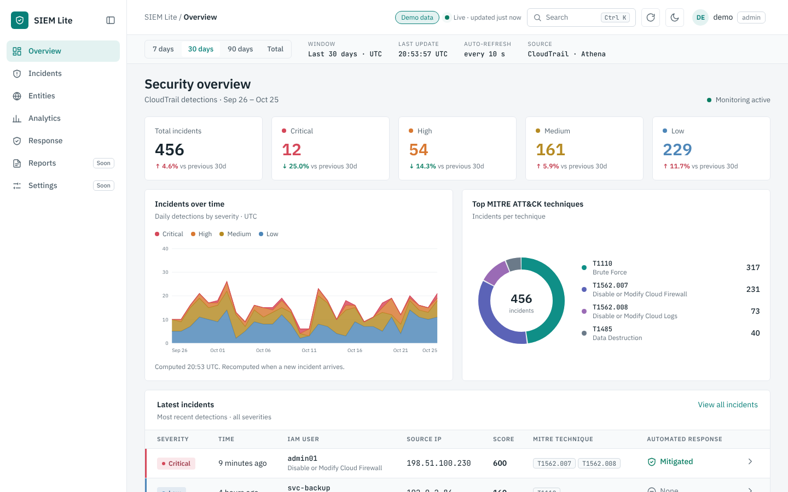
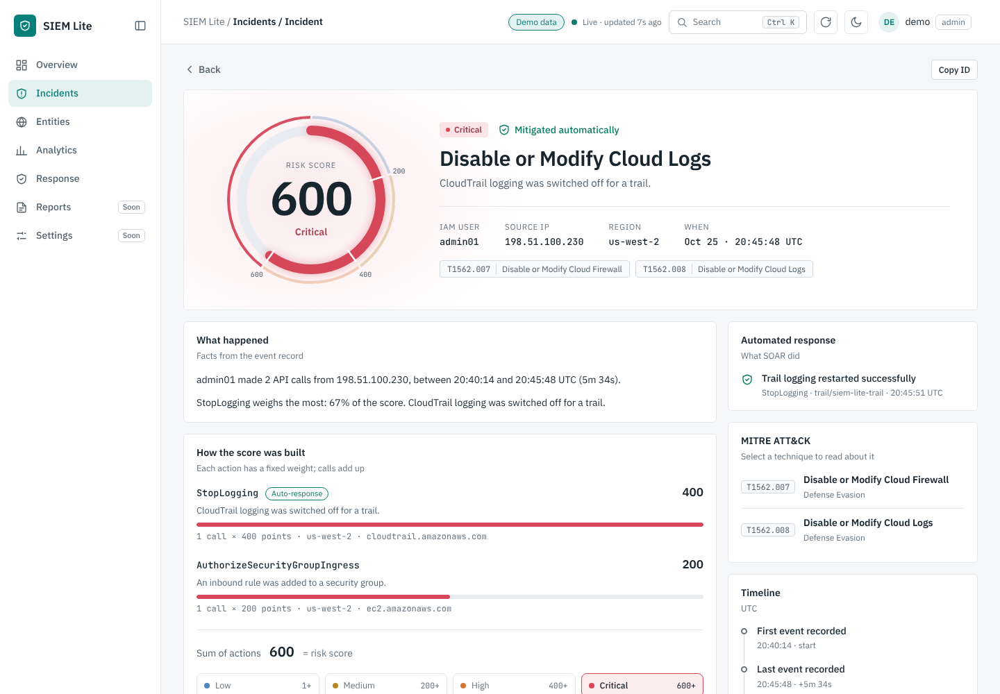
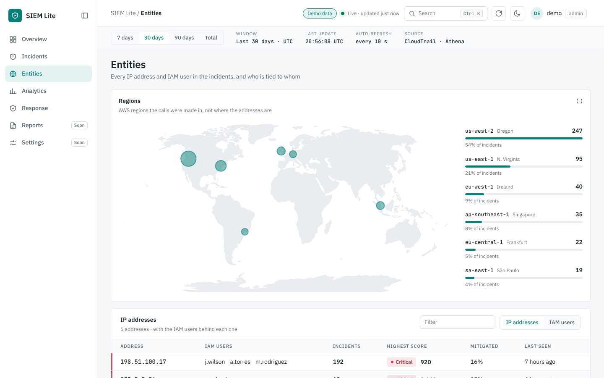
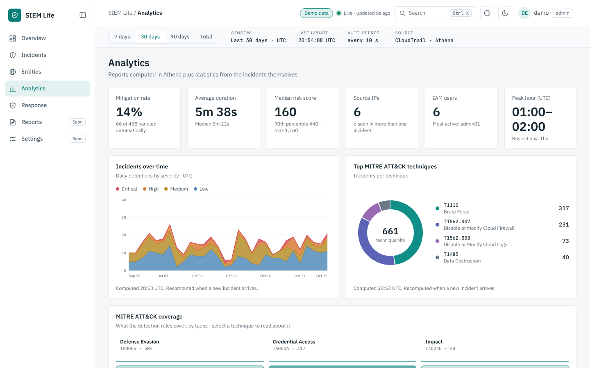
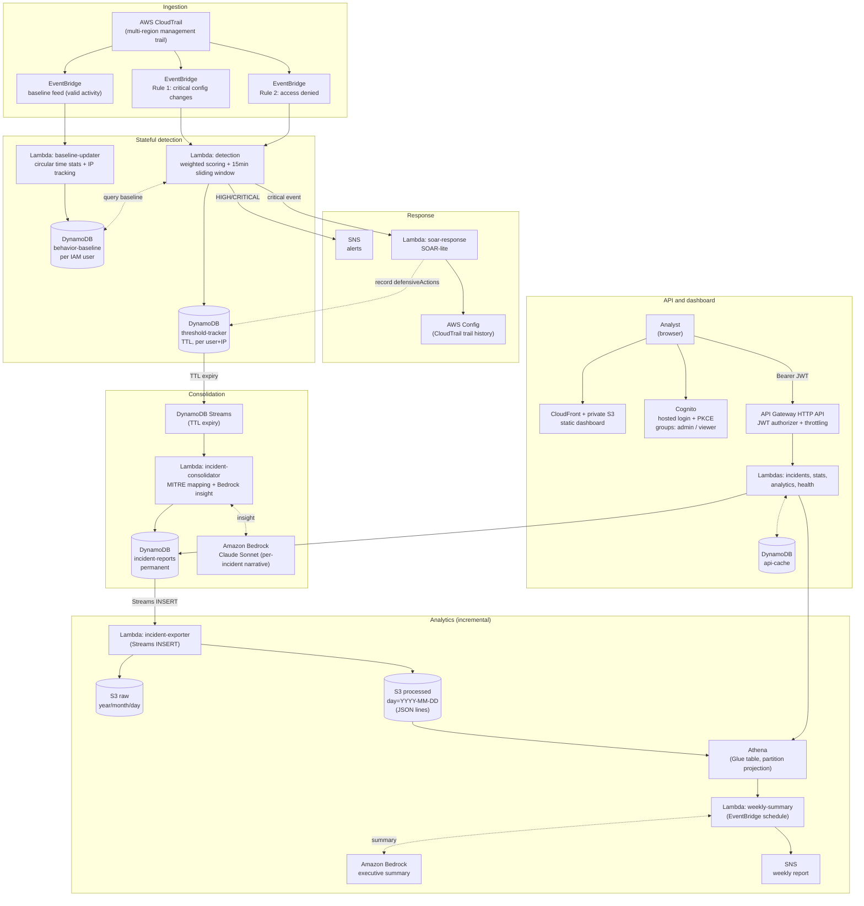

# SIEM Lite

[](https://github.com/Diego-do-na/SIEM-Lite/actions/workflows/ci.yml)

A serverless, event-driven SIEM that runs entirely inside your own AWS account. It watches CloudTrail for risky activity, scores it statefully per user and IP, asks an LLM (Amazon Bedrock) to write the analyst narrative, automatically repairs a small set of destructive changes, keeps an analytics history in S3 + Athena, and shows everything in an authenticated web dashboard. The whole thing is Terraform: one `terraform apply` creates it, one `terraform destroy` removes it.



*The dashboard's overview page. All screenshots in this document use the built-in demo data (`?mock=1`), not a real account.*

---

## Table of contents

- [What it does](#what-it-does)
- [Screenshots](#screenshots)
- [What it detects and what it fixes automatically](#what-it-detects-and-what-it-fixes-automatically)
- [Architecture](#architecture)
- [Pipeline walkthrough](#pipeline-walkthrough)
- [API and dashboard](#api-and-dashboard)
- [Rule 3: behavioral baseline (optional module)](#rule-3-behavioral-baseline-optional-module)
- [Getting started](#getting-started)
- [Try it](#try-it)
- [Using the dashboard](#using-the-dashboard)
- [Troubleshooting](#troubleshooting)
- [Cost](#cost)
- [Security model](#security-model)
- [Testing](#testing)
- [Key design decisions](#key-design-decisions)
- [Known limitations](#known-limitations)
- [Tech stack](#tech-stack)
- [Repository structure](#repository-structure)
- [Documentation](#documentation)
- [Roadmap](#roadmap)
- [References](#references)
- [License](#license)

---

## What it does

Most "SIEM in the cloud" tutorials stop at "CloudTrail → Lambda → alert". SIEM Lite goes further on purpose:

- **Stateful detection**, not single-event rules: activity is scored and accumulated per user and source IP over a sliding 15-minute window.
- **AI-assisted triage, not AI-as-classifier**: a deterministic scoring engine decides the severity first; Amazon Bedrock only writes the explanation afterwards. The model can never raise, lower or hide an alert.
- **Automated, reversible response (SOAR-lite)** for a narrow, justified set of destructive actions (someone turning off your audit trail or your encryption key), with an explicit, documented boundary on what it will *not* do.
- **An analytics tier** (S3 + Glue Data Catalog + Athena) behind the operational path, fed incrementally per incident, with no batch jobs to maintain.
- **A secured API and dashboard**: Cognito login, JWT authorizer, rate limiting, input validation, cache keyed by data version. The dashboard is served from a private S3 bucket through CloudFront with security headers.
- **Infrastructure as code with a security gate**: Terraform, Checkov in CI, and a protected `main` branch that cannot be merged with a failing scan.

Every non-obvious decision is deliberate and documented, including the ones that did not make it into 1.0 (see [decisions](docs/decisions.md) and [limitations](#known-limitations)).

## Screenshots

All of these are the demo data mode of the dashboard.

| | |
|---|---|
|  |  |
| **Incident page.** Risk score ring, the facts from the event record, how each action added to the score, what the automated response did, MITRE ATT&CK techniques and a timeline. | **Entities page.** Every source IP and IAM user, who is tied to whom, and a map of the AWS regions where the calls were made. |
|  | |
| **Analytics page.** Reports computed in Athena, statistics from the incidents themselves, and a coverage matrix of the ATT&CK techniques the rules can detect. | |

## What it detects and what it fixes automatically

### Detection rules

| Rule | Looks at | What it does |
|---|---|---|
| **Rule 1: critical configuration changes** | CloudTrail `StopLogging`, `DeleteTrail`, `UpdateTrail`; security group changes (`CreateSecurityGroup`, `DeleteSecurityGroup`, `Authorize`/`Revoke` `SecurityGroupIngress`/`Egress`); KMS `DisableKey`, `ScheduleKeyDeletion` | Adds the weight of the action to the user's running score. |
| **Rule 2: denied access** | Any call that fails with `AccessDenied`, `UnauthorizedAccess` or `Client.UnauthorizedAccess` on S3, IAM, EC2, KMS or STS | Adds about 40 points per denied call, so repetition (probing) is what raises the severity. Labeled `T1110` in MITRE terms; that label is generic, not proof of password guessing. |
| **Rule 3: behavioral baseline** (optional) | Valid activity of each IAM user | Multiplies the score of a new event when it happens at an unusual hour or from an unseen network. See [Rule 3](#rule-3-behavioral-baseline-optional-module). |

### Action weights and severity

| Action | Weight | MITRE ATT&CK | Automatic response |
|---|---:|---|---|
| `StopLogging` | 400 | T1562.008 | Logging is started again |
| `DeleteTrail` | 400 | T1562.008 | The trail is recreated from its last AWS Config configuration and verified |
| `DisableKey` | 400 | T1485 | The key is enabled again |
| `ScheduleKeyDeletion` | 400 | T1485 | The deletion is cancelled |
| `UpdateTrail` | 240 | T1562.008 | Alert only |
| `DeleteSecurityGroup` | 240 | T1562.007 | Alert only |
| `AuthorizeSecurityGroupIngress` | 200 | T1562.007 | Alert only |
| `CreateSecurityGroup` | 160 | T1562.007 | Alert only |
| `RevokeSecurityGroupIngress` / `AuthorizeSecurityGroupEgress` | 120 | T1562.007 | Alert only |
| `RevokeSecurityGroupEgress` | 80 | T1562.007 | Alert only |
| Any denied call (Rule 2) | about 40 | T1110 | Alert only |

The score of an incident is the sum of the weights of everything in it (it has no ceiling). The severity comes from fixed thresholds:

| Score | Severity |
|---:|---|
| 1 or more | Low |
| 200 or more | Medium |
| 400 or more | High |
| 600 or more | Critical |

An email alert (SNS) is sent for events at High or above. The four 400-point actions are the only ones that trigger an automatic response, and they always count toward the score even when the credentials are legitimate, because switching off your own audit trail is suspicious by itself.

## Architecture



## Pipeline walkthrough

1. **Ingestion.** A single multi-region CloudTrail trail (`siem_management_events`) captures all management read/write events. Two EventBridge rules split the stream by intent: **Rule 1** watches a small set of critical configuration changes (disabling logging, deleting or updating the trail, disabling or scheduling deletion of a KMS key, security group changes); **Rule 2** catches denied calls (`AccessDenied`, `UnauthorizedAccess`) on S3, IAM, EC2, KMS and STS, so a new type of denied action does not need a rule change.

2. **Stateful detection** (`detection`). Each matching event increments a per-action, per-`(user, sourceIP)` score in DynamoDB (`threshold_tracker`), inside a genuinely sliding 15-minute window: the TTL is recomputed on every new event rather than set once. Four "destructive" actions (`StopLogging`, `DeleteTrail`, `DisableKey`, `ScheduleKeyDeletion`) always contribute to the running score, even with legitimate credentials, because disabling your own audit trail is inherently suspicious. Everything else only scores after enough repetition to cross a threshold.

3. **Automated response (SOAR-lite)** (`soar_response`). Invoked asynchronously by the detection Lambda only for the four critical actions. It restarts CloudTrail logging, re-enables or cancels deletion of the KMS key, or recreates a deleted trail by reading its last known configuration from **AWS Config**. Idempotent per `(action, targetResource)`, so retries never double-remediate. Explicitly scoped to *protecting the resource*, not chasing the attacker (see [Known limitations](#known-limitations)).

4. **Consolidation and AI triage** (`incident_consolidator`). When an item in the tracker table expires, DynamoDB Streams (filtered to real TTL expirations, never manual deletes) triggers this Lambda. It maps the accumulated actions to MITRE ATT&CK techniques, computes a per-action score breakdown, and makes **one synchronous call to Amazon Bedrock (Claude Sonnet)** to generate a three-paragraph analyst narrative: what happened, why it matters (with the MITRE technique), and what to do next given what SOAR already mitigated. The finished incident is written once to `incident_reports` (no TTL, permanent record). If Bedrock fails, the incident is still saved with a fallback message instead of being lost.

5. **Incremental analytics** (`incident_exporter`). Every new incident that lands in the permanent table is streamed (Streams `INSERT` only) to S3 twice: a **raw** copy (`year=/month=/day=/<id>.json`, the unmodified record) and a **processed** copy as a single JSON line under `incidents/day=YYYY-MM-DD/<id>.json`. A Glue Data Catalog table with **partition projection** on that one `day` date partition exposes it to Athena: no crawler, no Glue job, no partition-registration step. Every query must filter on `day`; this is enforced in the code that builds the SQL (see [decisions](docs/decisions.md)).

6. **Weekly report** (`weekly_summary`). An EventBridge schedule (Sundays at 07:00 UTC) fires a Lambda that queries Athena for the trailing 7 days, aggregates by severity, source IP and MITRE technique, and, only if there is activity, asks Bedrock for a short executive summary before publishing to SNS. Bedrock receives the aggregates, never raw incident data.

> Resource names carry a configurable prefix (`<project_name>-<environment>`, for example `siem-lite-prod`), so a copy can live next to an existing deployment in the same account.

> **When does an incident show up?** An incident is written when its tracker item expires, which is 15 minutes after the last event of the burst. DynamoDB removes expired items in the background, usually within minutes but without a guaranteed time. The alert email and the automatic response happen immediately; only the consolidated incident in the dashboard comes later.

## API and dashboard

A read-only HTTP API exposes the incident store to a static dashboard.

- **Authentication:** Amazon Cognito user pool with hosted login (Authorization Code + PKCE), `admin` and `viewer` groups, admin-create-only (no self sign-up). API Gateway validates the JWT before any code runs.
- **Endpoints:** `GET /incidents` (filters, keyset pagination across severities, includes the AWS region of each incident), `GET /incidents/{severity}/{timestamp}`, `GET /stats` (counts and trend), `GET /analytics/{report}` (fixed Athena reports: top IPs, MITRE techniques, severity trend, score distribution; `days` limited to 7/30/90), `GET /health`. Full reference in [docs/api.md](docs/api.md).
- **Two separate defenses:** token validation (who may call) and input validation (what they may ask: allow-listed parameters, bounded sizes, no free-form SQL).
- **Abuse and cost control:** stage throttling (10 req/s, burst 20), CORS limited to the dashboard origins, and a **cache keyed by data version** (the timestamp of the last incident), so repeated dashboard loads never re-run Athena unless there is new data. Timed-out Athena queries are explicitly stopped.
- **Dashboard:** vanilla JS single-page app (no build step, no dependencies) in `frontend/`. `terraform apply` publishes it to a private S3 bucket behind CloudFront (Origin Access Control and security headers) and generates its `config.js` from the other resources. Tokens live in `sessionStorage` and all untrusted text is rendered with `textContent`. See [frontend/README.md](frontend/README.md) and [Using the dashboard](#using-the-dashboard).

## Rule 3: behavioral baseline (optional module)

Rule 3 (`enable_behavior_baseline`, default `false`) is a **context multiplier on top of the weighted score, not an independent detector**. With the flag off, the rest of the system behaves exactly as if Rule 3 did not exist.

- **What it does:** learns each IAM user's typical hour-of-day and source-IP ranges from their own valid activity, then multiplies the score of a new event by how far it deviates from that pattern.
- **Method:** circular statistics (Jammalamadaka & Lund, 2006): each observed hour becomes a unit vector on a 24-hour circle; the running sin/cos sums give a circular mean hour and a concentration $R$, from which the anomaly is a distance in standard deviations, floored at 1 hour. This avoids the discontinuity a linear hour-difference would have at midnight, and needs no labeled training data.
- **Why not ML:** there is no real, labeled attacker traffic in this account: all test traffic was generated by the author. ML is deferred to a later release, to be evaluated only against real accumulated data.
- **Safeguards:** cold start is neutral (multiplier = 1.0 until a user has enough distinct active days); critical actions never have their score *reduced* by the baseline, only amplified; only IAM users get a baseline (roles and services do not); only incremental accumulators are stored (sums, not a timestamp history), so the item size never grows with volume.

### The math

Each active hour bucket for a user contributes one unit vector. For an event at hour $h$ and minute $m$:

$$\theta = 2\pi \cdot \frac{h + m/60}{24}$$

Instead of storing every $\theta$, only the running sums are kept (that is what makes the accumulator constant-size):

$$S = \sum_{i=1}^{n} \sin\theta_i \qquad C = \sum_{i=1}^{n} \cos\theta_i$$

From those sums, the mean resultant length $R$ (how concentrated the user's activity is around one hour, from $0$ = scattered to $1$ = always the same hour) and the circular mean hour $\bar\theta$:

$$R = \frac{\sqrt{S^2 + C^2}}{n} \qquad \bar\theta = \text{atan2}(S, C)$$

The circular standard deviation, floored at 1 hour ($\sigma_{min} = 2\pi/24$ radians):

$$\sigma = \max\left(\sqrt{-2 \ln R},\ \sigma_{min}\right)$$

The new event's angular distance from the mean, wrapped correctly around midnight, then standardized:

$$d(\theta, \bar\theta) = \left|\left((\theta - \bar\theta + \pi) \bmod 2\pi\right) - \pi\right| \qquad z = \frac{d(\theta, \bar\theta)}{\sigma}$$

$z$ is mapped to a signal $s \in [-1, 1]$ ($z_{low}=1$, $z_{high}=3$ by default: clearly normal to clearly anomalous):

$$s = \text{clamp}\left(\frac{z - \frac{z_{low}+z_{high}}{2}}{\frac{z_{high}-z_{low}}{2}},\ -1,\ 1\right)$$

Confidence grows with distinct active days $d$ seen so far, toward $N_0 = 14$ by default:

$$\text{confidence} = \min\left(1, \frac{d}{N_0}\right)$$

Time and IP multipliers ($A$ = time amplitude, default $0.5$; $b$ = IP bump: $0$ known, $0.25$ new IP in a known range, $0.75$ never-seen range):

$$m_{time} = 1 + \text{confidence} \cdot A \cdot s \qquad m_{ip} = 1 + \text{confidence} \cdot b$$

And the final multiplier applied to the action's weight, capped at $M_{max} = 2.0$:

$$M = \min\left(m_{time} \cdot m_{ip},\ M_{max}\right)$$

**Privacy note.** Even in this reduced form, Rule 3 is behavioral profiling: it records when and from where a person works. Mitigations in place: only aggregated accumulators are kept (no per-event timeline), IP records expire after 30 days, the query path has read-only least-privilege IAM access, and no user-identifying data is written to CloudWatch. A deployment against real employees, rather than a personal test account, would need a defined purpose, employee notice, and a legal/HR review before enabling this flag.

## Getting started

You can run your own copy in about 30 minutes, most of it waiting for AWS. Nothing is shared: everything is created in your account and removed by `terraform destroy`.

### 1. What you need

- An **AWS account** and credentials that can create IAM roles, Lambda, DynamoDB, S3, Glue, Athena, API Gateway, Cognito, CloudFront, SNS, EventBridge (and CloudTrail and Config if you enable them). Use a test or sandbox account the first time.
- **Terraform 1.5 or newer** and **AWS CLI v2**, with credentials configured (`aws sts get-caller-identity` must work).
- **Amazon Bedrock model access** to the model in `bedrock_model_id` (default `us.anthropic.claude-sonnet-4-6`), enabled in your region from the Bedrock console. The default is a US inference profile, so use a US region (for example `us-east-1`, `us-east-2` or `us-west-2`) or set `bedrock_model_id` to a profile available in yours.
- A **real email address** you can read: it receives the alerts and the first login password.
- Optional: Python 3 (to preview the dashboard locally or run the helper scripts).

### 2. Get the code and set your variables

```bash
git clone https://github.com/Diego-do-na/SIEM-Lite.git
cd SIEM-Lite/backend/infra
cp terraform.tfvars.example terraform.tfvars
```

Edit `terraform.tfvars`. The three values you must set:

```hcl
aws_region               = "us-east-2"
alert_email              = "you@example.com"
enable_behavior_baseline = false
```

All the variables:

| Variable | Default | What it does |
|---|---|---|
| `aws_region` | none | Region where everything is deployed. |
| `alert_email` | none | Receives SNS alerts (you must confirm the subscription email) and becomes the first Cognito admin. |
| `enable_behavior_baseline` | none | Turns on [Rule 3](#rule-3-behavioral-baseline-optional-module). |
| `enable_cloudtrail` | `false` | `true` creates the multi-region CloudTrail trail and its log bucket. Leave `false` if your account already has one. |
| `enable_config` | `false` | `true` creates the AWS Config recorder. SOAR needs it to recreate a deleted trail. |
| `enable_event_rules` | `true` | `false` deploys everything without wiring CloudTrail events into detection, which is safe for a first look. |
| `dashboard_origins` | `["http://localhost:5173"]` | Extra origins allowed by CORS and by the Cognito redirect (local development). The CloudFront address is added automatically. |
| `monthly_budget_usd` | `5` | Account-wide monthly budget; emails you at 80% actual and 100% forecast. |
| `enable_cli_auth` | `false` | Lets you get Cognito tokens from the CLI. Only for `scripts/smoke-test.sh`; keep `false` in anything shared. |
| `bedrock_model_id` | `us.anthropic.claude-sonnet-4-6` | Model used for the incident narrative and the weekly summary. |
| `project_name`, `environment` | `siem-lite`, `dev` | Resource name prefix is `<project_name>-<environment>`. |
| `baseline_*`, `ip_ttl_days` | see `variables.tf` | Rule 3 tuning. |

> To see the full pipeline react to real events you need `enable_cloudtrail = true` and `enable_config = true` (and `enable_event_rules = true`, the default). For a first look at the dashboard and API, the defaults are enough.

### 3. Deploy

```bash
terraform init
terraform validate
terraform plan        # read it: about 100 resources
terraform apply
terraform output
```

Useful outputs: `frontend_url` (the dashboard), `api_url`, `cognito_login_url`, `cognito_user_pool_id`, `cognito_client_id`. The first CloudFront distribution takes 5 to 10 minutes to be ready.

Also check your inbox: **confirm the SNS subscription** (alerts will not arrive until you do) and keep the email with the temporary password.

### 4. First login

Open the `frontend_url` address. It sends you to the Cognito hosted login. Sign in with your `alert_email` and the temporary password from the email, then choose a new one. If you prefer to set a permanent password from the command line:

```bash
aws cognito-idp admin-set-user-password \
  --user-pool-id <cognito_user_pool_id> \
  --username <alert_email> \
  --password '<12+ characters>' --permanent
```

The dashboard starts empty: there are no incidents until something happens (or you run the seed script below).

### 5. Add more users

Users are admin-created only. In the Cognito console (or with `aws cognito-idp admin-create-user`), create the user and add them to the `viewer` or `admin` group.

### 6. Update the dashboard later

The dashboard files are part of the Terraform state. Edit anything under `frontend/` and run `terraform apply`: the changed files are uploaded, and browsers revalidate them on the next load.

### 7. Tear it down

```bash
aws s3 rm s3://<raw bucket> --recursive
aws s3 rm s3://<processed bucket> --recursive
terraform destroy
```

The `raw` and `processed` buckets hold incident data and are deliberately not removed while they contain objects, so empty them first (bucket names are in `terraform output s3_buckets`). If you enabled CloudTrail, Terraform removes the trail only after the rules and Lambdas that would recreate it are gone, so run `destroy` as one command. CloudWatch log groups that Lambda creates on its own (`/aws/lambda/<function>`) are not managed by Terraform; delete them by hand if you want a clean account. More detail in [docs/deployment.md](docs/deployment.md).

## Try it

### See the dashboard with fake data (no AWS needed)

```bash
cd frontend
python3 -m http.server 5173
```

Open `http://localhost:5173/index.html?mock=1`. This is the demo mode used for the screenshots above (`?mock=empty` and `?mock=error` show the empty and error states).

### Insert synthetic incidents into your deployment

From `backend/infra`, with your region exported:

```bash
export AWS_REGION=us-east-2          # the region you deployed to
../../scripts/seed-incidents.sh
```

This writes seven incidents (all severities, several source IPs and regions) into the `incident_reports` table. The DynamoDB stream then exports them to S3 exactly like real incidents, so they appear in the dashboard and in Athena. Running it again replaces the previous synthetic incidents.

### Trigger a real detection (test account only)

This needs `enable_cloudtrail = true`, `enable_config = true` and `enable_event_rules = true`. Use an account where briefly switching off logging is acceptable.

```bash
# Switch off the trail; SOAR should start it again within seconds
aws cloudtrail stop-logging --name siem_management_events
aws cloudtrail get-trail-status --name siem_management_events --query IsLogging
```

You should get an alert email, `IsLogging` should be `true` again almost immediately, and about 15 minutes later (see [When does an incident show up?](#pipeline-walkthrough)) the incident appears in the dashboard with the automated response listed. A burst of denied calls from the same identity (repeated calls to an API your credentials are not allowed to use) raises a Low, Medium or High incident depending on how many there are, at roughly 40 points each. Deleting the trail (`aws cloudtrail delete-trail`) is also repaired: it is recreated from its last AWS Config configuration and checked, although tags are not restored.

### Check the API from the command line

Needs `enable_cli_auth = true` while you test (turn it off afterwards):

```bash
cd backend/infra
SMOKE_EMAIL=<alert_email> SMOKE_PASSWORD='<permanent password>' ../../scripts/smoke-test.sh
```

It checks that `/health` is public, that every other route returns 401 without a token, that the endpoints work with one, and that bad input is rejected with 400.

## Using the dashboard

| Page | What you find |
|---|---|
| **Overview** | Incident counts by severity compared with the previous period, incidents over time, top MITRE ATT&CK techniques and the latest incidents. |
| **Incidents** | The full list with filters (severity, date range, IP, user, technique) and pagination. Open one to see the risk score, the facts, how each action added to the score, what SOAR did, the MITRE techniques, a timeline and the Bedrock narrative. |
| **Entities** | Every source IP and IAM user with its incidents, highest score and mitigation rate, plus a map of the AWS regions where calls were made. Each IP and user has its own page. |
| **Analytics** | Reports computed in Athena (top IPs, techniques, severity trend, score distribution), statistics from the incidents, and the ATT&CK coverage matrix with the tactics that have no rule listed as gaps. |
| **Response** | A preview of a future "protected resources" view. The backend for it is not built yet. |
| **Reports, Settings** | Placeholders marked "Soon". |

Things worth knowing:

- Range selector: 7, 30 or 90 days, or Total (the Athena reports are limited to 7/30/90 days).
- The page refreshes itself every 10 seconds, and a toast appears when a new incident arrives.
- Press `Ctrl K` (or `Cmd K`) to search incidents, IPs, users, techniques and pages.
- Every chart card can be expanded; the expanded view explains how to read the chart, what stands out, and shows the exact numbers.
- Select any technique id to open its ATT&CK card: what it is, how it looks in AWS, how SIEM Lite detects it and what the automated response does.
- Sessions end after 30 minutes without activity, with a warning first. There is a light and a dark theme.

## Troubleshooting

| Symptom | Likely cause and fix |
|---|---|
| `terraform apply` fails on Bedrock or the Lambda cannot call the model | Model access is not enabled. Enable the model in the Bedrock console in your region, or set `bedrock_model_id` to a profile available there. Incidents are still saved without the narrative. |
| Login page says `redirect_mismatch` | The address you opened is not one of the Cognito callback URLs. Use the `frontend_url` output exactly (with `https://`), or add your local origin to `dashboard_origins` and apply again. |
| The CloudFront address returns an error right after `apply` | The distribution is still deploying. Wait 5 to 10 minutes. |
| The dashboard loads but shows a "session" or `401` message | Your login expired or the user has no group. Sign in again and check the user is in the `viewer` or `admin` group. |
| The dashboard is empty | Normal on a new deployment. Run `scripts/seed-incidents.sh`, or generate real events and wait for the incident to be consolidated (about 15 minutes after the last event). |
| No alert emails | You did not confirm the SNS subscription, or `enable_event_rules` is `false`, or CloudTrail is not enabled. |
| `seed-incidents.sh` says `Output "dynamodb_tables" not found` | Run it from `backend/infra`, where the Terraform state is. |
| Scripts fail with a region or access error | Export `AWS_REGION` to the region you deployed to (the scripts default to `us-east-2`). |
| After a dashboard change the browser shows the old version | Hard refresh or use a private window. The files are served with `Cache-Control: no-cache`, but a restored tab can keep the old scripts. |
| `terraform destroy` fails on a bucket | Empty the `raw` and `processed` buckets first (see [Tear it down](#7-tear-it-down)). |

## Cost

Cost is pay-per-use and idles near zero: on-demand DynamoDB, Lambda, HTTP API, CloudFront's free tier. The pieces that grow with real activity are Bedrock (one call per incident plus one per week), Athena queries, and CloudTrail and AWS Config data if you enable them. In the author's test account the whole stack cost a few US dollars in a month of testing, including the Config recorder. An AWS Budget (`monthly_budget_usd`, default 5, applied to the whole account) emails you before it gets out of hand, and CloudWatch alarms watch the API and Lambda errors. Check the AWS pricing pages for your region before leaving it running.

## Security model

- **Authentication and authorization:** Cognito hosted login with Authorization Code + PKCE, admin-created users only, `admin` and `viewer` groups, JWT validated by API Gateway before any code runs. The API is read-only.
- **Input handling:** allow-listed query parameters, bounded sizes, a forged pagination cursor is rejected, and Athena only runs fixed, parameterized reports with a mandatory date predicate.
- **Dashboard hosting:** the S3 bucket is private and only reachable through CloudFront (Origin Access Control); TLS is required; responses carry a strict Content-Security-Policy, HSTS, `nosniff`, `X-Frame-Options: DENY`, `no-referrer` and a restrictive Permissions-Policy. The page loads no third-party scripts, styles or fonts.
- **Browser side:** tokens in `sessionStorage`, all untrusted text rendered with `textContent`, automatic logout after 30 minutes of inactivity.
- **Least privilege:** one IAM role per Lambda, scoped to the tables, buckets and actions it needs.
- **Data:** encrypted at rest with AWS-managed keys; Bedrock receives incident facts and aggregates, never raw logs.
- **Supply chain and CI:** no dependencies in the dashboard (nothing to patch), the CI workflow never receives AWS credentials, and every change goes through Terraform validate and Checkov on a protected `main`.

The threat model, the accepted Checkov exceptions and the known gaps are in [docs/security.md](docs/security.md).

## Testing

| What | How |
|---|---|
| Infrastructure | `terraform validate` and Checkov on every pull request; both are required checks on `main`. |
| API logic | Exercised locally against mocked DynamoDB: pagination with ties across severities, every filter, invalid input, detail lookup, cache behavior, error responses without internals. |
| Real AWS | `scripts/smoke-test.sh` (auth, status codes, input validation) and `scripts/seed-incidents.sh` (the whole pipeline with synthetic incidents). |
| Detection and response on real events | Run on 25 Oct 2026 in `us-west-2` with real CloudTrail and Config events. |

Results of the real-event tests:

| Test | Result |
|---|---|
| `StopLogging` | Detected as critical, alert sent, logging restarted about 2 seconds after detection. |
| Burst of denied calls | Score accumulated per user and IP and crossed the High and Critical thresholds. |
| `DeleteTrail` | Trail recreated from AWS Config history and verified in about 1 to 2 minutes; only the tags were lost. |
| Consolidation | One incident per user and IP, with MITRE techniques, score breakdown and the response that ran. |

The test that exposed a real bug (the detector crashed on denied calls whose `requestParameters` is `null`) is described, with the fix, in [docs/testing.md](docs/testing.md).

## Key design decisions

| Decision | Why |
|---|---|
| DynamoDB over RDS/Aurora | Avoids VPC and connection-pool complexity; fits a fully serverless design end to end. |
| Two DynamoDB tables (ephemeral + permanent) | A single table with TTL would risk expiring records meant to be kept; separating "working state" from "case record" removes that failure mode entirely. |
| Weighted action pool per `(user, IP)` instead of a flat counter | Different actions carry different risk; a map (`actionCounts`/`configChanges`) lets each action keep its own count, score, timeline and context, at the cost of a 3-step nested `update_item` pattern to work around DynamoDB's "overlapping document paths" restriction. |
| Bedrock called once, synchronously, inside the consolidator | Keeps the insight generation on the write path (computed once, read many times) instead of re-generating it on every read or adding another Lambda hop. |
| Bedrock triage after scoring, never before | The LLM never decides severity: it explains a decision a deterministic engine already made. This keeps the alerting path auditable and removes the LLM as a single point of failure for detection itself. |
| SOAR scoped to "protect the resource," not "punish the actor" | No credential revocation or user disablement: that requires an identity-governance system with its own blast-radius analysis, out of scope here by design. |
| SOAR only reports success after verifying the final state | A recreated trail that is not logging is not a remediation. Found as a real bug: `create_trail` does not start logging. |
| Incremental ETL instead of a weekly Glue batch | The first design batched raw data into Parquet weekly. Replaced by writing one small JSON line per incident at insert time: no job to schedule or fail, data queryable immediately, and at this volume Parquet gives no benefit. Parquet + compaction returns in 1.1 when volume justifies it. |
| One date partition with projection, and a mandatory `day` predicate | Year/month/day projection over several years created thousands of candidate partitions and made queries on seven files take 14 to 100 seconds; a single projected date partition brought them to about a second. Partition pruning has to be a rule, not a habit. |
| Cache keyed by data version, not only by time | Dashboards re-query constantly; the version (last incident timestamp) invalidates exactly when data changes. A 60 s floor and per-endpoint max age bound staleness and cost. |
| HTTP API + Cognito JWT authorizer, read-only | Lowest cost and least surface: no writes through the API in 1.0, authentication enforced before the Lambda runs. |
| Dashboard on private S3 + CloudFront with Origin Access Control | The bucket is never public and the security headers are set at the edge. The content security policy allows any API Gateway of the same region in `connect-src` to avoid a circular dependency with the API's CORS settings; the real protection is the JWT. A custom API domain would remove the wildcard. |
| Caching: `no-cache` with ETags on every object | CloudFront and browsers revalidate on each load, so a deploy is visible immediately without invalidations, and 304 responses keep it cheap. |
| Alarms on a separate SNS topic | CloudWatch cannot publish to a topic encrypted with the AWS-managed `alias/aws/sns` key; a customer-managed key is planned for 1.1. |
| Terraform + Checkov as a merge gate | `main` is protected: PR required, and both `Terraform validate` and `Checkov` must pass. Verified with a deliberately failing PR. Accepted risks are skipped with a written reason. |

## Known limitations

Documented deliberately, because a security project that only lists what works is not credible:

- The system assumes credentials are legitimate; detecting a *compromised* credential behaving normally would require full UEBA, out of scope for this version.
- Tested on accounts with no other workload; the noise of a real, actively used account is covered only by what was simulated. The detection paths were validated manually on real AWS (see [Testing](#testing)) rather than by automated end-to-end tests.
- The tracker key is `(user, sourceIP)`: an attacker who rotates IPs mid-attack currently splits their score across items instead of accumulating it (planned for 1.1).
- An alert email is sent for every event at High or above, so one burst can produce several emails (deduplication per window is planned).
- A failure inside the detector (for example, an unexpected event shape) is logged but not surfaced as an alarm yet.
- Rule 2 covers denied calls on S3, IAM, EC2, KMS and STS only, and security-group changes score but do not trigger an automatic response.
- Rule 3 has a cold-start blind spot: a brand-new user has a neutral multiplier for their first weeks. Rules 1 and 2 (and the base weights) still protect during that window.
- The hourly baseline is unimodal: a user with split shifts (for example 9-14 and 20-23) gets averaged toward an hour they never actually work.
- The IP signal produces false positives for a single user who legitimately appears under several source IPs (IPv4, IPv6, a privacy relay), confirmed in testing with Safari's "Hide IP from Trackers," which routed console traffic through a Cloudflare relay IP.
- Rule 3 is triage (it adjusts priority), not detection: it never flags anything Rules 1 and 2 would not already flag, and with self-generated test data its separation power cannot be rigorously measured. The baseline only covers IAM users.
- Cognito MFA, AWS WAF, customer-managed KMS keys, S3 access logs and dead-letter queues are not in 1.0 (Checkov skips are listed in `backend/infra/.checkov.yaml` with reasons). Data is encrypted at rest with AWS-managed keys.
- The long-lived IAM key used to administer a test account should be replaced by SSO or role-based access in a real environment.
- The API lists and filters incidents with DynamoDB filter expressions, which is fine at this volume and will need Athena-backed search at scale.
- Incidents are processed one account and one region at a time; there is no multi-account or multi-region aggregation yet.

## Tech stack

**AWS:** CloudTrail, EventBridge, Lambda (Python), DynamoDB (+ Streams), SNS, Amazon Bedrock (Claude Sonnet), AWS Config, S3, CloudFront, Glue Data Catalog, Athena, API Gateway (HTTP API), Cognito, CloudWatch, AWS Budgets.

**Infrastructure and CI:** Terraform (AWS provider 6.x), GitHub Actions (`terraform validate`, Checkov), branch protection on `main`.

**Frontend:** vanilla HTML/CSS/JS with no build step and no dependencies; hosted on private S3 behind CloudFront.

## Repository structure

```
backend/
  functions/
    pipeline/    detection, baseline_updater, soar_response,
                 incident_consolidator, incident_exporter, weekly_summary
    api/         incidents, stats, analytics, health
  shared/        scoring, MITRE map, behavior baseline, API utilities
  infra/         Terraform (one file per resource type) + .checkov.yaml
frontend/        static dashboard (published by Terraform; config.example.js for local use)
scripts/         smoke-test.sh, seed-incidents.sh, rotate-admin-key.sh
docs/            architecture, api, security, deployment, testing, decisions, roadmap
.github/workflows/ci.yml
```

## Documentation

| Doc | Contents |
|---|---|
| [architecture](docs/architecture.md) | Components, data flow, guard rails |
| [api](docs/api.md) | Endpoints, parameters, errors |
| [security](docs/security.md) | Query-path threat model, authentication, frontend hosting, known gaps |
| [deployment](docs/deployment.md) | Variables, deploy, first login, verify, tear down, CI |
| [testing](docs/testing.md) | CI, local Lambda tests, checks and detection tests against real AWS |
| [decisions](docs/decisions.md) | Numbered decisions for the API, analytics and dashboard |
| [roadmap](docs/roadmap.md) | 1.0 closing items, 1.1 and 1.2 |
| [frontend/README](frontend/README.md) | Dashboard structure, configuration and demo mode |

## Roadmap

**1.0 (deployed and validated):** the stack runs on real AWS (us-west-2), the dashboard is served from a private S3 bucket through CloudFront, and the detection and response paths were tested with real CloudTrail and Config events (StopLogging, DeleteTrail and denied calls; see [Testing](#testing)).

**1.1 (hardening and depth):** Cognito MFA, WAF, customer-managed KMS keys, dead-letter queues and S3 access logs, Parquet with periodic compaction and a backfill script, an admin-only `POST /actions` (acknowledge/close, manual SOAR re-run) with audit trail, Athena-backed search, and the detection improvements below.

**Detection improvements (1.1 / 1.2):**

- **Score resilient to IP rotation.** Aggregate scoring per user, not just per `(user, IP)`.
- **Action-diversity signal.** Weight a burst of *different* reconnaissance actions higher than repetition of the same one.
- **Event-sequence correlation.** Detect known attack chains (for example a security-group change followed by broadening an ingress rule).
- **Recalibrated severity thresholds** against real traffic, and **MFA-aware scoring**.
- **Rule 3 baseline improvements.** Group IPv4/IPv6/relay addresses per user, support multimodal schedules, separate weekday/weekend patterns, handle time zones.
- **SOAR v2 and recovery tags.** Opt-in resource tagging so automated response can safely cover actions currently excluded for being ambiguous. A resource tagged for recovery would have its configuration saved by SIEM Lite and rebuilt if it is deleted or altered. The dashboard already has the Response page and a preview of the protected-resources view; the backend (tag convention, snapshots, restore) is not built.
- **ML-based anomaly detection**, evaluated only once real account activity exists to train and validate against.
- **PDF weekly reports** from a LaTeX template compiled in a container-image Lambda.

**1.2:** to be defined after 1.1 (multi-account ingestion, more notification channels, tunable rules from the UI).

## References

Jammalamadaka, S. R., & Lund, U. J. (2006). *Circular statistics.* Encyclopedia of Statistical Sciences. Basis for the Rule 3 time-of-day anomaly signal.

## License

[MIT](LICENSE). You can use, modify and redistribute this project, including commercially, as long as the copyright notice is kept. It comes with no warranty: review the Terraform plan and the [security notes](docs/security.md) before running it in an account you care about.
