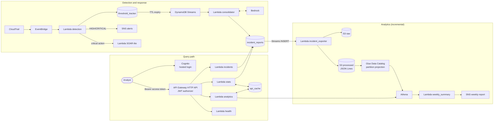

# Architecture

SIEM Lite is a serverless pipeline: detection and response on the operational path, analytics and a
read-only API/dashboard on the query path. Everything is defined in Terraform (`backend/infra`), one `.tf`
file per service.

## Overview



The detection tier, SOAR-lite and Bedrock triage are described in the [README](../README.md#pipeline-walkthrough).
This document covers what sits behind the incident table.

## Data flow of an incident

1. The consolidator writes one item to `incident_reports` (PK `severity`, SK `timestamp`, permanent).
2. DynamoDB Streams (INSERT only) invokes `incident_exporter` within seconds.
3. The exporter writes two objects per incident:
   - **raw**: the original event, `year=YYYY/month=MM/day=DD/<incidentId>.json`. Untouched, for audit or
     reprocessing.
   - **processed**: one curated, flat JSON line under `incidents/day=YYYY-MM-DD/<incidentId>.json`
     (lower-case columns, `actionnames` as a set, `responsetaken` boolean, `hourutc`, ...). This is what
     Athena reads.
4. The Glue table `incidents` uses **partition projection** (a single date partition `day` is computed from the
   query, no crawler and no `MSCK REPAIR`), so a new object is queryable as soon as it lands.
5. The dashboard polls `GET /stats`; when `lastIncidentAt` changes it reloads the feed and the analytics.

Result: the analytics are as fresh as the last incident, and there is no second copy of the same data in
two formats (raw is the source of truth, processed is the curated projection).

## Query path

| Piece | Role |
|---|---|
| Cognito user pool | Users, groups (`admin`, `viewer`), hosted login, Authorization Code + PKCE |
| API Gateway HTTP API | Routing, CORS, JWT validation, throttling, access logs |
| 4 Lambdas (`backend/functions/api/*`) | `incidents`, `stats`, `analytics`, `health`; shared helpers in `backend/shared/api_utils.py` |
| `api_cache` (DynamoDB, TTL) | Cache keyed by report, validated by the version of the data |
| Athena workgroup | Analytics SQL, `bytes_scanned_cutoff_per_query` = 1 GiB |
| `frontend/` | Static SPA (vanilla JS, no build step) |

### Cache by version

An answer is reusable as long as the data it was computed from has not changed. The "version" is
`lastIncidentAt`: the timestamp of the newest incident (one `Query` of one item per severity, four reads).

`api.is_cache_valid(cached, version, now, max_age, min_age=60)` serves the cached payload when:

- its age is below `min_age` (60 s floor, protects Athena from bursts of incidents), or
- its version equals the current version and its age is below `max_age` (analytics 6 h, stats 300 s;
  the "last N days" and "last 24 h" windows slide even without new incidents).

Why: `/stats` is polled every 10 s, and counting incidents reads the whole partition. With the cache the
steady-state cost of polling is four one-item reads.

## Infrastructure layout

```
backend/
  functions/
    pipeline/      detection, baseline_updater, soar_response, consolidator, incident_exporter, weekly_summary
    api/           incidents, stats, analytics, health
    analytics/     siem_lite_incident_transformer.py (kept for the 1.1 compaction job)
  shared/          api_utils.py (responses, cursor, cache rule, counts)
  infra/           one .tf per service (api, athena, cognito, dynamodb, glue, iam, lambda, s3, sns, ...)
frontend/          static dashboard
docs/
```

## Cost profile

Everything is pay-per-use and idle-free; the target is under USD 1 per month at portfolio volumes.

| Item | Order of magnitude |
|---|---|
| Athena | USD 5/TB scanned, 10 MB minimum per query, about USD 0.00005 per query |
| Incremental ETL (one small Lambda invocation per incident + S3 PUTs) | about USD 0.04/month for ~100 medium and ~3 critical incidents |
| Previous design (weekly Glue job + crawler) | about USD 0.3 to 0.5/month, plus stale data |
| API Gateway, Lambda, DynamoDB on-demand, Cognito | inside or near the free tier at this volume |
| Bedrock | the main variable cost; one call per incident plus one weekly summary |

Guard rails: Athena per-query scan cutoff (1 GiB), API throttling (10 rps, burst 20), cache floor of 60 s,
and a manual AWS Budget alert.
